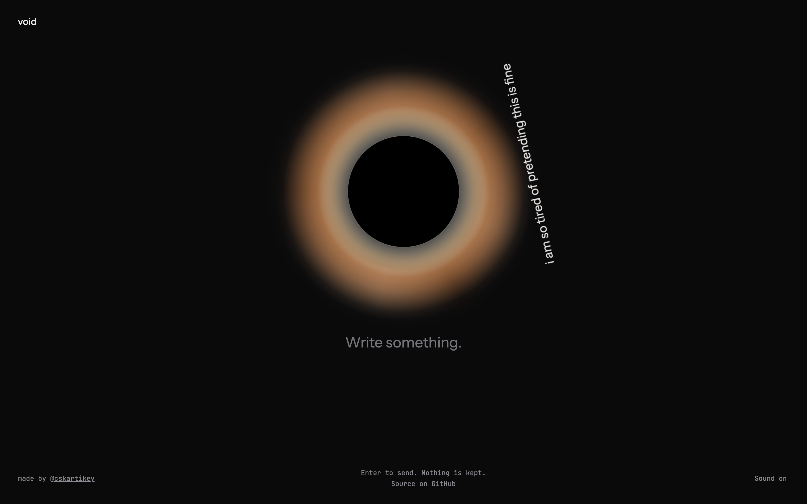

# void

Type something, press Enter, and it spirals into a black hole.



This simply exists when I want to vent out and don't want to bother a friend. 

Nothing is preserved.

## Run it

It's a simple vanilla html, css and js app....

Open `index.html` in a browser.

To serve it locally instead:

```sh
python3 -m http.server
```

Then go to http://localhost:8000.

## Keys

- `Enter` sends
- `Shift + Enter` adds a new line

## Deploy

It's served as static assets on Cloudflare Workers at https://void.cskartikey.dev.

```sh
npx wrangler login
npx wrangler deploy
```

`.assetsignore` keeps the README, the screenshot and the config out of the upload.
